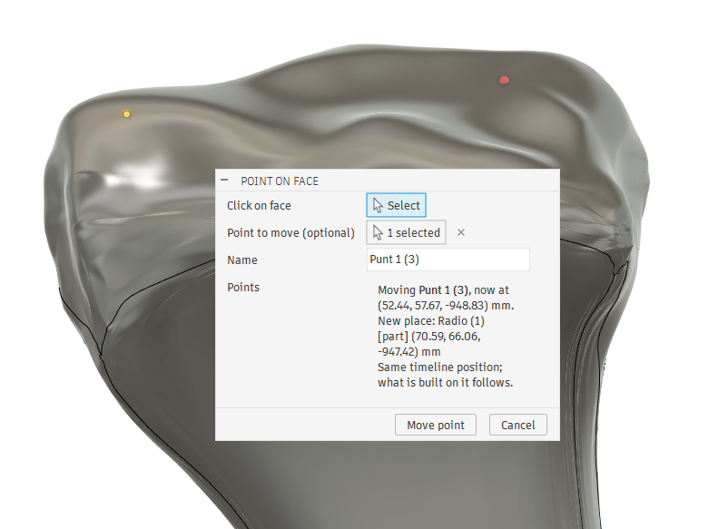
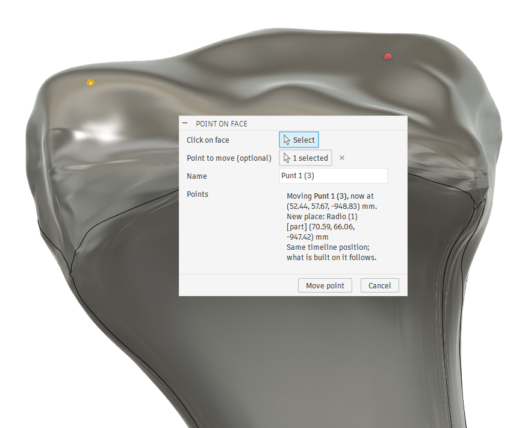

# Point On Face (FacePoint)

A Fusion 360 add-in that creates **construction points exactly where you click on a face** of a
solid, and can **move an existing point** to a new place on a face. Made for anatomical
landmarks on bone models, such as the tips of the styloid processes or the points that
define an articular plane.

## Why

Fusion's own Construct menu can only place points on:
- Vertices;
- Edges;
- Intersections of planes or edges;
- Centres of circles and spheres.

None of those lets you put a point **anywhere on a face**. On an organic bone model (a
NURBS body made from a scan), the landmarks you need are in the middle of large faces,
far from any vertex or edge. This add-in creates them where you click.

## Using it

**Solid → Construct → Point On Face**

1. Open **Point On Face**. The dialog has two boxes:
   - **Click on face**, which is active from the start;
   - **Point to move**, which stays empty unless you want to move a point.
2. Click on a face where you want a point. Each click adds a point, and several on the
   same face are fine. A small sphere marks each click: orange, and the last one red.
   - **Remove last point** and **Clear all points** undo clicks.
3. Give the points a **name**. One point takes the name as it is; several are numbered
   `Name 1`, `Name 2`, …
4. Optionally keep **Group in timeline** ticked: the points are then kept together in one
   timeline group with that name.
5. Press **OK**. The points are created in the root component, on the faces you clicked.

   
  <em>Figure 1. First point created (orange) and last point created (red).</em>

### Moving a point

Editing a point from the timeline opens Fusion's own Point dialog, which can't place it on
a face. Instead:
1. Select the point (in the browser or the timeline), then run **Point On Face**. Or, with
   the command open, click the **Point to move** box and pick the point.
2. Click on a face where the point should go. The old place is marked orange, and the new
   one red.
3. Press **Move point**.

It is the **same point**: it keeps its timeline position and its name, and whatever is
built on it (planes, axes, measurements) follows.

   
  <em>Figure 2. Old location (orange) and new location (red).</em>

## Install

1. Clone or copy this folder anywhere.
2. Run `powershell -File install.ps1`. It copies the add-in to
   `%APPDATA%\Autodesk\Autodesk Fusion 360\API\AddIns\FacePoint`.
3. In Fusion: **Utilities → ADD-INS → Scripts and Add-Ins → Add-Ins**, select
   **FacePoint**, keep *Run on Startup* ticked, and press **Run**.
4. The button appears in **Solid → Construct**, after Fusion's own point commands.

No extra Python packages are needed.

## How it works

- **Several clicks on one face:** Fusion lets an entity be selected only once per command,
  and clicking a selected face deselects it. So each click is recorded (the point and the
  face) in a hidden input of the dialog, and the selection is cleared straight away. That
  leaves the face free for the next click.
- **Placing:** each point is a construction point defined by a **snap point** on the
  clicked face (`ConstructionSnapPoint`), at the exact spot of the click. It also works on
  a face inside a component.
- **Moving:** `redefineBySnapPoint` redefines the existing point on the new face, so it
  stays the same feature.
- **The marks** are drawn in Fusion's preview step. Graphics drawn at any other moment are
  discarded by Fusion at its next preview.

## Repository layout

| Path | |
|---|---|
| `FacePoint.py` | add-in shell: lifecycle, toolbar button, events |
| `fp_core.py` | the dialog, creating and moving points, the marks; re-imported on every command |
| `install.ps1` | copies the add-in into Fusion's AddIns folder |
| `resources/FacePoint/` | toolbar icons |
| `tools/make_icons.py` | draws the icons |

## Tests

There are no offline tests: the add-in only uses Fusion's API. It was tested inside Fusion,
in throwaway documents, on bodies at the root and inside components, both creating and
moving points.

## Known limits

- **The points don't follow the face** if the body changes or moves later, like Fusion's
  own *Point at Vertex*. Move them again with **Point to move**.
- **A point can't be moved onto a face created later in the timeline** than the point.
  Fusion refuses it, and the dialog says so.
- **Only faces of solid bodies** can be clicked, not mesh bodies.
- **Timeline groups** need a parametric design (with history) and at least two points.

## Licence

MIT. See `LICENSE`.
